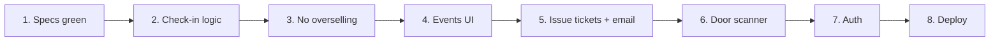

# showtime-tickets: next steps (mentor notes)

As of 2026-11-22.

Your domain model is in good shape: two models, solid validations, and database constraints that back them up. The next stretch is about **proving** it works (specs), then building the first slice a real user can click through. Everything below is ordered, so do it top to bottom.

- **Part 1 (sections 1–7):** what to do and why.
- **Part 2 (sections 8–24):** offline reference, with cheat sheets for what you'd otherwise look up. **Offline? Start at section 24**, a plan for one hour.

---

## 1. Where you are

| Area | State | Notes |
| --- | --- | --- |
| `Event` model | Done | Presence, length, `ends_at > starts_at`, capacity > 0, capacity can't drop below issued tickets |
| `Ticket` model | Done | Secure token, read-only `event_id`/`token`, email normalization, email-or-phone rule, capacity and "event started" guards on create |
| DB schema | Good | `NOT NULL`s, check constraints, unique index on `token`, FK to events. The DB enforces the rules too, not only Rails. |
| Factories | **Broken, uncommitted** | See section 3 |
| Specs | None | Both spec files hold only a `pending` placeholder |
| CI on `main` | Green | Last run 2026-11-02. It's green only because there are no real specs yet. |
| Dependabot PRs | 7 open, red | `scan_ruby` → `bin/bundler-audit` fails on them |
| Controllers / routes / views | None | Only the health check route |
| README | Rails default | |

## 2. The idea, as the code shows it

Here's what I can read from the schema. Correct me where I'm wrong:

- An **organiser** creates an **event** with a start, an end, a location and a capacity.
- **Tickets** go to named holders, reachable by email or phone. Each ticket has an unguessable **token**, which will later become a QR code or link.
- At the door, staff **check in** a ticket (`checked_in_at`).
- There are no prices, payments or user accounts yet.

So this is a guest-list and check-in tool, not a shop. Keep it that way until check-in works end to end.

## 3. Immediate next steps (this week)

### 3.1 Fix the factories

You hit this before: `NoMethodError: undefined method 'start'`. Read the error, then read `spec/factories/events.rb` line by line against `db/schema.rb`. Questions to guide you:

- Which column name does the schema use? Which name does your `ends_at` block call?
- Inside a FactoryBot block you can refer to another attribute directly. Do you need `instance.` at all?

In `spec/factories/tickets.rb`:

- `event { nil }`: `belongs_to :event` is required by default. What happens on `create(:ticket)`? Look up FactoryBot **associations**.
- `checked_in_at` has a fixed default, so **every** ticket starts out checked in, and your `:checked_in` trait changes nothing. What should the default be?
- `Time.now` and `Time.current` differ. You set the time zone to Europe/Lisbon. Which one respects it?

How to check: open `bin/rails console -e test` and run `FactoryBot.create(:ticket)`. It should save with no errors.

> Rule of thumb: **a factory's default must build a valid record**, and traits add the variations.

### 3.2 Write your first model specs

Start with `Event`. There's one spec per rule, and the test name should read like the rule. Example shape (one rule only, the rest is yours):

```ruby
RSpec.describe Event, type: :model do
  it "has a valid factory" do
    expect(build(:event)).to be_valid
  end

  it "requires ends_at to be after starts_at" do
    event = build(:event, ends_at: 1.week.ago)
    expect(event).not_to be_valid
    expect(event.errors[:ends_at]).to be_present
  end
end
```

Cover every rule in both models. The interesting ones:

- Capacity reached: build an event with `capacity: 1`, create one ticket, then expect a second ticket to be invalid.
- Event already started: how do you get an event with a past `starts_at` when your own factory says the future? (Hint: `travel_to`, from `ActiveSupport::Testing::TimeHelpers`.)
- Capacity lowered below the tickets already issued.
- Email normalization: `"  Foo@Bar.COM "` should be stored as `"foo@bar.com"`.
- `attr_readonly`: what actually happens when you change `token` and save? Write a test to find out. Don't guess.

Finish when `bundle exec rspec` has zero pending and zero failures. Then commit the factories and specs together.

### 3.3 Sort out the Dependabot PRs

All of them fail on `bin/bundler-audit`. Their `test` and `lint` jobs pass. That usually means a gem you already use has a known vulnerability, so `main` would fail too if CI ran today.

1. Run `bin/bundler-audit` locally and read which gem and advisory it names.
2. Check whether one of the open PRs (look at #4, `rails 8.1.4.1`) is the fix.
3. Merge that one first, rebase the others (`@dependabot rebase` as a PR comment), then merge them one at a time.
4. Be careful with #3 (`image_processing` 1.x → 2.x), a **major** bump. Read its changelog first. Do you even use it yet?

## 4. Roadmap



Ship each milestone as **one small PR with specs**, merged only once CI is green.

| # | Milestone | What you build | What you learn |
| --- | --- | --- | --- |
| 1 | Specs green | Section 3 | RSpec, FactoryBot, time helpers |
| 2 | Check-in logic | `Ticket#check_in!` that refuses a second check-in and refuses tickets for other days | Domain methods on models, `update!` vs `update`, custom errors |
| 3 | No overselling | Make the capacity check safe when two requests arrive at once | Race conditions, row locks, transactions |
| 4 | Events UI | CRUD for events: index, show, new/edit forms | Routes, controllers, strong params, forms, request specs |
| 5 | Issue tickets | Form to issue a ticket; email with a link built from the token | Nested routes, Action Mailer, Solid Queue jobs (`deliver_later`) |
| 6 | Door scanner | Page where staff enter or scan a token and see "valid / already used / wrong event" | Stimulus, Turbo Frames, system specs |
| 7 | Auth | Only organisers manage events; door staff only check in | `bin/rails generate authentication` (Rails 8), authorization |
| 8 | Deploy | Put it online | Kamal (already configured), credentials, production DB |

### Milestone 3 in more detail

This is the most valuable lesson in the project, so take your time. Today the check is:

```ruby
errors.add(:base, "Event capacity reached") if event.tickets.count >= event.capacity
```

Picture two requests for the last seat at the same moment. Both run `count`, both see 99 out of 100, and both save. That's 101 tickets. Validations cannot stop this, because they read and then write as two separate steps.

What to do:

1. Write a spec that **shows** the bug. It's hard to do with threads in a test, so first explain it on paper and in the PR description.
2. Read about `ActiveRecord::Locking::Pessimistic` (`lock`, `with_lock`).
3. Move ticket creation into one place, a class method or a small service object, that locks the event row, counts, then creates, all inside one transaction.
4. Ask yourself: does `capacity_not_below_issued_tickets` on `Event` have the same race?

## 5. Concepts to study, in order of need

- **Validations vs DB constraints.** You already do both. Can you explain why? What does a user see when only the constraint catches an error? (Answer: `ActiveRecord::StatementInvalid`, a 500 page.)
- **`build` vs `create` in specs.** Use `build` unless the test needs the row in the DB. Your specs run faster that way.
- **Request specs over controller specs.** RSpec recommends request specs now. Test through HTTP:

  ```ruby
  it "creates an event" do
    expect {
      post events_path, params: { event: attributes_for(:event) }
    }.to change(Event, :count).by(1)
  end
  ```

- **Fat model, thin controller, then service objects** once a model method starts touching several models or external systems (milestone 5).
- **Background jobs.** Never send email inside the request. `deliver_later` hands it to Solid Queue.
- **Time zones.** `Time.current`, `travel_to`, and storing UTC while displaying Lisbon time.
- **Hotwire.** Turbo Drive is on by default. Learn Turbo Frames (replace part of a page) before Turbo Streams.

Official guides worth reading in full: Active Record Validations, Active Record Associations, Testing Rails Applications, Action Mailer Basics, Active Job Basics, and Working with JavaScript in Rails.

## 6. Habits

- **Red, green, refactor.** Write the failing spec first, watch it fail for the right reason, then write the code.
- **Small commits, present tense, one idea each.** Your history already does this well ("Add capacity validation to Event model"), so keep going.
- **Branch and PR, even solo.** `main` only gets merged PRs with green CI. You get practice reading your own diff.
- **Read the whole error.** The `start` bug was right there in the message. Before searching, read the class, the method name and the file:line.
- **Run CI locally first:** `bin/rubocop`, `bin/brakeman`, `bin/bundler-audit`, `bundle exec rspec`. Consider a `bin/ci` script that runs all four.
- **Write the README as you go:** setup, how to run tests, and what the app does. Future you will need it.

## 7. Questions to answer before building

Write your answers down. Most of them change the schema, so decide before milestone 4, not after.

1. **Does door check-in need to work offline?** Venue Wi-Fi is often bad. If yes, the scanner page must cache the guest list (token → name) on the device, check people in locally, and sync later. That's a PWA with a service worker; `app/views/pwa/` already exists. It also raises a conflict question: two staff phones check in the same ticket while both are offline. Decide this **before** milestone 6.
2. **Can a ticket be cancelled or refunded?** If so, does it free a seat? That affects what "issued tickets" means in your capacity count.
3. **Can one person hold several tickets for the same event?** Should that need one holder per ticket, or a quantity?
4. **Should `checked_in_at` be a timestamp or a separate `CheckIn` record** (who checked them in, at which door)?
5. **Phone numbers:** what format, and do you normalize them the way you do emails?
6. **Can events be edited after tickets are issued?** Moving `starts_at` into the past would block new tickets. Is that intended?
7. **Who are the users?** One organiser, or many organisers each with their own events? This decides how milestone 7 looks.

---

# Part 2: Offline reference

These notes are written for **your** versions: Rails 8.1.4, rspec-rails 8.0.4, factory_bot 6.6.0, turbo-rails 2.0.23, stimulus-rails 1.3.4, Ruby from `.ruby-version`. The examples are generic on purpose. They show the API, not the answer to your milestone.

## 8. Before you lose the connection (if you still have a minute)

New gems can't be installed offline. None of these are on your machine yet:

| Gem | Needed for | When |
| --- | --- | --- |
| `bcrypt` | `bin/rails generate authentication` (milestone 7) | Later |
| `capybara`, `selenium-webdriver` | System specs (milestone 6) | Later |

Nothing in the next hour needs them. Model specs and request specs work with what you have.

## 9. Finding docs on your own machine

Gems ship their source, and the Rails source is heavily commented. Often it *is* the API documentation.

```sh
bundle info factory_bot                 # version + path on disk
bundle open activerecord                # opens the gem in $EDITOR (set EDITOR=code / vim)
cat "$(bundle info --path factory_bot)/GETTING_STARTED.md"   # FULL FactoryBot guide, offline
cat "$(bundle info --path rspec-rails)/README.md"
ls  "$(bundle info --path rspec-rails)/lib/rspec/rails/matchers"   # every rspec-rails matcher

# grep the Rails source for a method and read the comment above it
grep -rn "def with_lock" "$(bundle info --path activerecord)/lib"
grep -rn "def travel_to"  "$(bundle info --path activesupport)/lib"
```

In the console:

```ruby
Event.method(:where).source_location      # => file + line, then open it
Ticket.instance_method(:save!).owner      # which module defines it
Event.validators                          # every validator on the model
Event.validators_on(:capacity)
Ticket.reflect_on_all_associations.map(&:name)
```

Rails' own tooling:

```sh
bin/rails routes                 # all routes; -g ticket to filter, -c events for one controller
bin/rails generate --help        # list generators
bin/rails generate model --help  # options for one generator
bin/rails -T                     # all rake/rails tasks (db:..., test:...)
bin/rails about                  # versions, env, adapter
bundle exec rspec --help
```

**A sandbox app works offline**, because all of Rails' gems are already installed. Use it to see what a generator produces without touching your project:

```sh
cd /tmp && rails new sandbox --database=postgresql --skip-bundle && cd sandbox
bundle install --local
bin/rails generate scaffold Thing name:string starts_at:datetime
# read app/controllers/things_controller.rb, the views, the routes. Then delete the folder.
```

## 10. Two config gaps in this repo

1. **Time helpers aren't included.** `travel_to` raises `NoMethodError` in specs until `spec/rails_helper.rb` has this inside `RSpec.configure`:
   ```ruby
   config.include ActiveSupport::Testing::TimeHelpers
   ```
2. **Spec types aren't inferred from folders** (`infer_spec_type_from_file_location!` is not enabled). Always tag the type: `type: :model`, `type: :request`, `type: :mailer`. Without `type: :request`, `get events_path` won't work.

## 11. RSpec cheat sheet

```ruby
RSpec.describe Thing, type: :model do
  let(:thing)  { build(:thing) }     # lazy: built on first use, fresh per example
  let!(:other) { create(:thing) }    # eager: created before each example
  subject(:result) { thing.valid? }

  before { travel_to Time.zone.local(2026, 12, 1, 20, 0) }   # runs before each example

  describe "#method_name" do         # "#" = instance method, "." = class method
    context "when the thing is full" do
      it "does X" do
        expect(thing.size).to eq(3)
      end
    end
  end
end
```

Matchers you'll use most:

| Matcher | Example |
| --- | --- |
| equality | `expect(x).to eq(3)` |
| truthiness / predicate | `expect(record).to be_valid`, `be_persisted`, `be_nil`, `be_present` (calls `present?`) |
| collections | `include("a")`, `contain_exactly(a, b)`, `be_empty` |
| errors on a record | `expect(record.errors[:name]).to include("can't be blank")` |
| error by kind (sturdier than message text) | `expect(record.errors.of_kind?(:name, :blank)).to be(true)` |
| side effect | `expect { action }.to change(Thing, :count).by(1)` |
| no side effect | `expect { action }.not_to change(Thing, :count)` |
| change of an attribute | `expect { t.touch }.to change { t.reload.updated_at }` |
| exceptions | `expect { record.save! }.to raise_error(ActiveRecord::RecordInvalid)` |
| attributes | `expect(record).to have_attributes(name: "x", size: 2)` |
| time | `expect(t).to be_within(1.second).of(Time.current)` |
| HTTP (request specs) | `expect(response).to have_http_status(:ok)`, `redirect_to(thing_path(t))` |

Running:

```sh
bundle exec rspec                                  # all
bundle exec rspec spec/models/event_spec.rb        # one file
bundle exec rspec spec/models/event_spec.rb:12     # one example (by line)
bundle exec rspec --format documentation           # read like a spec sheet
bundle exec rspec --only-failures                  # setting exists in spec_helper.rb but sits inside the =begin/=end block (lines 49-93); move it out to enable
```

`fit` / `fdescribe` focus one example (remove before committing). `xit` skips one. `aggregate_failures` inside an `it` reports every failed expectation, not only the first.

## 12. FactoryBot cheat sheet

The full guide is on disk: `cat "$(bundle info --path factory_bot)/GETTING_STARTED.md"`.

```ruby
build(:thing)                  # new object, NOT saved (fast, use by default)
create(:thing)                 # saved (runs validations, hits DB)
build_stubbed(:thing)          # fake saved object, no DB at all (fastest)
attributes_for(:thing)         # plain hash, handy for request-spec params
create_list(:thing, 3)
build(:thing, name: "Override")
build(:thing, :big, :red)      # with traits
```

Definitions:

```ruby
FactoryBot.define do
  factory :book do
    title { "Dune" }
    published_on { 1.year.ago }
    reviewed_on { published_on + 1.week }   # attributes can refer to each other directly
    sequence(:isbn) { |n| "978-#{n}" }      # unique per call
    author                                  # association: builds/creates an :author
    # or explicitly: association :author, factory: :writer

    trait :unpublished do
      published_on { nil }
    end

    transient do                            # inputs that are NOT attributes
      chapter_count { 0 }
    end

    after(:create) do |book, ctx|
      create_list(:chapter, ctx.chapter_count, book: book)
    end
  end
end
```

Keep `create` minimal in specs. Every `create` of a ticket also creates its event, which is fine, but `create_list(:ticket, 100)` creates 100 events unless you pass `event: some_event`.

Sanity check for all factories: `FactoryBot.lint` in `bin/rails console -e test` builds every factory and reports the invalid ones.

## 13. Time in tests and in the app

```ruby
travel_to Time.zone.local(2026, 12, 24, 21, 0)   # stays until the example ends
travel_to(2.days.from_now) { ... }               # block form, restored after
freeze_time                                       # Time.current stops moving
travel 1.hour                                     # move forward from now
```

- In app code, use `railTime.current` / `Time.zone.now` (your zone: Europe/Lisbon), never `Time.now` (the server's zone).
- The DB stores UTC. Rails converts on read. `Date.current` is the same idea for dates.
- `1.week.from_now`, `2.hours.ago`, `beginning_of_day`, and `event.starts_at.to_date == Date.current` are all handy.

## 14. Active Record reference

### Validations

```ruby
validates :name, presence: true, length: { maximum: 200 }
validates :code, uniqueness: { scope: :event_id, case_sensitive: false }   # + a unique DB index!
validates :size, numericality: { only_integer: true, greater_than: 0 }
validates :kind, inclusion: { in: %w[vip general] }
validates :ends_at, comparison: { greater_than: :starts_at }
validates :email, format: { with: URI::MailTo::EMAIL_REGEXP }, allow_blank: true
validate  :custom_rule                       # private method that calls errors.add
validate  :only_on_create, on: :create
validates :x, presence: true, if: :something?
```

The errors API: `errors.add(:field, :blank)` (a symbol gives a translatable error type) or `errors.add(:base, "message")`. Read them with `errors.full_messages`, `errors[:field]` or `errors.details`.

### Save variants (know which ones skip validations)

| Method | Validations | Callbacks | On failure |
| --- | --- | --- | --- |
| `save` / `update(attrs)` | yes | yes | returns `false` |
| `save!` / `update!` / `create!` | yes | yes | raises `RecordInvalid` |
| `update_column(s)` | **no** | **no** | writes straight to DB |
| `touch` | no | some | sets timestamps |
| `update_all` / `delete_all` | **no** | **no** | one SQL statement |

In controllers, use the non-bang version and branch on it. In services, scripts and specs, use the bang version so failures are loud.

### Transactions and locking (milestone 3 toolkit)

```ruby
ActiveRecord::Base.transaction do
  a.update!(...)
  b.update!(...)          # if this raises, a's change is rolled back too
end
```

Pessimistic lock: other transactions trying to lock the same row **wait** until you finish.

```ruby
account = Account.find(id)
account.with_lock do                   # opens a transaction, SELECT ... FOR UPDATE, reloads the row
  raise "insufficient funds" if account.balance < amount
  account.update!(balance: account.balance - amount)
end

Account.lock.find(id)                  # same lock, inside your own transaction
```

Optimistic lock: add an integer column `lock_version` (default 0, null false). Rails then raises `ActiveRecord::StaleObjectError` when someone else saved first. It suits rare conflicts, like edit forms. For "last seat" contention, prefer the pessimistic lock.

Another option is to let the DB be the referee. A `counter_cache` (`belongs_to :event, counter_cache: true` plus a `tickets_count` column) combined with a check constraint `tickets_count <= capacity` makes the DB reject the oversold insert. It's harder to get right, so read about it after you've done the lock version.

### Queries

```ruby
Event.where(location: "Lisbon").where("starts_at > ?", Time.current).order(:starts_at)
Event.where.not(description: nil)
Event.where(starts_at: Time.current..)            # open-ended range
Ticket.where(checked_in_at: nil).count
Ticket.find_by(token: "abc")                       # nil if missing
Ticket.find_by!(token: "abc")                      # raises RecordNotFound -> 404 in controllers
Event.includes(:tickets)                           # avoid N+1 in index pages
event.tickets.exists?(holder_email: "a@b.c")
Event.where(...).to_sql                            # see the SQL without running it
scope :upcoming, -> { where(starts_at: Time.current..) }   # in the model
```

### Migrations

```sh
bin/rails generate migration AddNotesToEvents notes:text
bin/rails db:migrate
bin/rails db:rollback            # undo last; STEP=2 for more
bin/rails db:migrate:status
```

```ruby
add_column :events, :notes, :text
add_index  :tickets, [:event_id, :holder_email], unique: true
add_reference :tickets, :user, foreign_key: true, null: true
add_check_constraint :events, "capacity <= 10000", name: "events_capacity_max"
change_column_null :tickets, :holder_name, false
```

Never edit a migration that's already committed and run elsewhere. Write a new one instead. The test DB updates itself through `maintain_test_schema!` in `rails_helper.rb`.

## 15. Routes, controllers, forms

### Routes

```ruby
resources :events do
  resources :tickets, shallow: true        # /events/:event_id/tickets/new, but /tickets/:id
end

resources :tickets, only: [] do
  member     { post :check_in }            # POST /tickets/:id/check_in
  collection { get :search }               # GET  /tickets/search
end

resolve("Ticket") { [:ticket] }            # rarely needed; ignore for now
root "events#index"
```

Check the result with `bin/rails routes -c tickets`.

### A controller, Rails 8 style

```ruby
class BooksController < ApplicationController
  before_action :set_book, only: %i[show edit update destroy]

  def index = @books = Book.order(:title)
  def show; end
  def new  = @book = Book.new

  def create
    @book = Book.new(book_params)
    if @book.save
      redirect_to @book, notice: "Book created."
    else
      render :new, status: :unprocessable_content   # 422: REQUIRED for Turbo to show the errors
    end
  end

  def destroy
    @book.destroy!
    redirect_to books_path, status: :see_other     # 303 after DELETE, required by Turbo
  end

  private
    def set_book = @book = Book.find(params.expect(:id))
    def book_params = params.expect(book: [:title, :published_on])   # Rails 8 strong params
end
```

- `params.expect` is the Rails 8 replacement for `params.require(...).permit(...)`. Malformed params get a 400 instead of a 500.
- Use `:unprocessable_content` (422). Older tutorials say `:unprocessable_entity`, the pre-Rack-3.1 name, which now triggers a deprecation warning. Verified: your Rails 8.1.4 scaffold generates `:unprocessable_content`.
- **The #1 Turbo surprise:** if a failed form renders with status 200, Turbo ignores it and the errors never appear. Always send 422.

### Nested create (ticket under an event)

```ruby
@event  = Event.find(params.expect(:event_id))
@ticket = @event.tickets.build(ticket_params)     # sets event_id for you
```

### Forms

```erb
<%= form_with model: @book do |f| %>             <%# nested: model: [@event, @ticket] %>
  <% if @book.errors.any? %>
    <ul><% @book.errors.full_messages.each do |m| %><li><%= m %></li><% end %></ul>
  <% end %>

  <%= f.label :title %>          <%= f.text_field :title %>
  <%= f.label :published_on %>   <%= f.datetime_field :published_on %>
  <%= f.number_field :pages, min: 1 %>
  <%= f.email_field :email %>    <%= f.telephone_field :phone %>
  <%= f.text_area :notes %>
  <%= f.submit %>
<% end %>
```

Other view helpers: `link_to "Edit", edit_book_path(@book)`, `button_to "Delete", @book, method: :delete` (a real form, so it works without JS), `l(@event.starts_at, format: :long)`, `pluralize(n, "ticket")`, `time_ago_in_words(t)`. Flash goes in the layout as `<%= notice %>` and `<%= alert %>`.

Tailwind is installed. Run the app with `bin/dev` (the Procfile), not `bin/rails s`, so the CSS rebuilds.

## 16. Request specs

```ruby
require "rails_helper"

RSpec.describe "Books", type: :request do
  describe "POST /books" do
    it "creates and redirects" do
      expect {
        post books_path, params: { book: attributes_for(:book) }
      }.to change(Book, :count).by(1)
      expect(response).to redirect_to(book_path(Book.last))
    end

    it "re-renders with 422 when invalid" do
      post books_path, params: { book: { title: "" } }
      expect(response).to have_http_status(:unprocessable_content)
      expect(response.body).to include("can&#39;t be blank")   # HTML-escaped apostrophe
    end
  end
end
```

Test behaviour (status, redirect, DB change), not which template rendered.

## 17. Mailers and background jobs (milestone 5)

```sh
bin/rails generate mailer Receipt sent
```

```ruby
class ReceiptMailer < ApplicationMailer
  def sent
    @order = params[:order]
    mail to: @order.email, subject: "Your receipt"
  end
end

ReceiptMailer.with(order: order).sent.deliver_later   # enqueue (use this)
ReceiptMailer.with(order: order).sent.deliver_now     # inline (scripts, debugging)
```

- Links in emails need a full URL: `book_url(@book)`, not `_path`. Dev already has `default_url_options` set to localhost:3000.
- **Previews**: preview classes go under `spec/mailers/previews/` (check the generator output) and show at `http://localhost:3000/rails/mailers`. They work offline, so you see the email without sending it.
- In development, sent mail shows up in `log/development.log`.

Testing:

```ruby
expect { do_the_thing }.to have_enqueued_mail(ReceiptMailer, :sent)

mail = ReceiptMailer.with(order: order).sent
expect(mail.to).to eq([order.email])
expect(mail.body.encoded).to include(order.reference)
```

Your test environment already uses the `:test` queue adapter (Active Job sets it by default when `RAILS_ENV=test`), so these matchers work as they are.

Jobs:

```sh
bin/rails generate job CleanupStale
```

```ruby
class CleanupStaleJob < ApplicationJob
  queue_as :default
  def perform(event_id)          # pass IDs, not objects with huge state
    Event.find(event_id)...
  end
end

CleanupStaleJob.perform_later(event.id)
CleanupStaleJob.set(wait: 1.hour).perform_later(event.id)
```

Production uses Solid Queue (the jobs live in Postgres, so there's no Redis). Recurring jobs go in `config/recurring.yml`.

## 18. Hotwire: Turbo + Stimulus (milestones 4 and 6)

### Turbo Frames: replace one part of the page

```erb
<%= turbo_frame_tag "search_result" do %>
  <p>Nothing yet.</p>
<% end %>

<%= form_with url: search_path, method: :get, data: { turbo_frame: "search_result" } do |f| %>
  <%= f.search_field :q %>
<% end %>
```

The response must contain a `turbo_frame_tag` with the **same id**. Turbo swaps only that frame. If the ids don't match you get "Content missing" in the frame. A link inside a frame with `data: { turbo_frame: "_top" }` navigates the whole page.

### Turbo Streams: change several places at once

```ruby
respond_to do |format|
  format.turbo_stream   # renders create.turbo_stream.erb
  format.html { redirect_to ... }
end
```

```erb
<%# create.turbo_stream.erb %>
<%= turbo_stream.prepend "books", @book %>
<%= turbo_stream.update "counter", @count %>
```

Learn Frames first. You may never need Streams.

### Stimulus: small JS sprinkles

```sh
bin/rails generate stimulus counter   # app/javascript/controllers/counter_controller.js, auto-registered
```

```js
import { Controller } from "@hotwired/stimulus"

export default class extends Controller {
  static targets = ["output", "input"]
  static values  = { step: { type: Number, default: 1 } }

  connect() {               // element appeared on the page
    this.count = 0
  }

  increment(event) {
    event.preventDefault()
    this.count += this.stepValue
    this.outputTarget.textContent = this.count
  }
}
```

```html
<div data-controller="counter" data-counter-step-value="2">
  <span data-counter-target="output">0</span>
  <button data-action="click->counter#increment">+</button>
  <input data-counter-target="input" data-action="keydown.enter->counter#increment">
</div>
```

The naming rules are where most bugs hide: the file is `counter_controller.js`, the controller is `data-controller="counter"`, targets are `data-counter-target`, and values are `data-counter-<name>-value`. A two-word name like `door_scanner_controller.js` becomes `door-scanner` in HTML. Your `hello_controller.js` is a working example.

Debugging: open the browser console, run `Stimulus.debug = true` (or set `application.debug = true` in `app/javascript/controllers/application.js`), and watch controllers connect.

## 19. Offline / PWA basics (if question 1 is "yes")

Rails 8 already gave you the files: `app/views/pwa/manifest.json.erb` and `app/views/pwa/service-worker.js`. To switch them on:

1. Uncomment the two `pwa` routes in `config/routes.rb` (lines 9 and 10).
2. In `app/views/layouts/application.html.erb`, uncomment the manifest `<link>` tag.
3. Register the worker in JS:
   ```js
   if ("serviceWorker" in navigator) navigator.serviceWorker.register("/service-worker")
   ```

What a service worker is: a script the browser runs **between your page and the network**. It can answer requests from a cache when there's no network.

```js
// service-worker.js: minimal "network first, cache as fallback"
const CACHE = "v1"

self.addEventListener("install", (e) => {
  e.waitUntil(caches.open(CACHE).then((c) => c.addAll(["/offline"])))
})

self.addEventListener("fetch", (e) => {
  if (e.request.method !== "GET") return
  e.respondWith(
    fetch(e.request)
      .then((res) => { caches.open(CACHE).then((c) => c.put(e.request, res.clone())); return res })
      .catch(() => caches.match(e.request).then((hit) => hit || caches.match("/offline")))
  )
})
```

Things that bite:

- Service workers only run on **HTTPS or localhost**.
- The browser keeps the old worker until every tab closes. Change the `CACHE` name to force an update. While developing, open Chrome DevTools → Application → Service Workers and tick "Update on reload".
- A cache stores **responses** (pages, assets). Data that changes offline, like "ticket X was checked in at 21:04", needs browser storage: `localStorage` for a small JSON list (simple, about 5 MB, synchronous) or IndexedDB for anything bigger.
- When the network returns, POST the queued check-ins to the server. The server then decides what to do with conflicts, such as one ticket checked in on two phones. That's a domain rule, so write it as a spec first.

## 20. Authentication (milestone 7, needs `bcrypt`, so do it online)

`bin/rails generate authentication` creates:

- a `User` model (`email_address`, `password_digest`, `has_secure_password`), plus a `Session` model and migrations;
- a `Current` model (per-request globals) and an `Authentication` controller concern included in `ApplicationController`;
- a `SessionsController` (login/logout) and a `PasswordsController` + mailer (reset).

Every controller then requires login by default. To open specific actions:

```ruby
allow_unauthenticated_access only: %i[show]
```

The signed-in user is `Current.user`. **There's no sign-up page.** Write it yourself, which is good practice for milestone 4 skills. Roles like organiser vs door staff are up to you. The simplest version is an enum column on `User`.

## 21. Debugging

```ruby
debugger            # or binding.break: pauses here (in app code, specs or console)
```

At the `(rdbg)` prompt: `n` next line, `s` step into, `c` continue, `p expr` print, `info` locals, `bt` backtrace, `q` quit.

```sh
bin/rails console --sandbox      # everything rolls back on exit
tail -f log/test.log             # SQL each spec ran
tail -f log/development.log
```

In the console, `reload!` picks up code changes and `record.errors.details` shows why a save failed.

## 22. Error → what it usually means

| Error | Usual cause |
| --- | --- |
| `NoMethodError: undefined method 'x' for an instance of Y` | Typo or wrong column name. Compare with `db/schema.rb`. |
| `undefined method 'x' for nil` | Something you expected to exist didn't (`find_by` returned nil, missing association) |
| `ActiveRecord::RecordInvalid: Validation failed: Event must exist` | `belongs_to` without the parent, e.g. a factory with `event { nil }` |
| `ActiveRecord::NotNullViolation` / `PG::CheckViolation` | The DB constraint caught what validations missed. Add the matching validation. |
| `ActiveRecord::RecordNotUnique` | Unique index hit, often a race between two inserts |
| `ActiveRecord::PendingMigrationError` | Run `bin/rails db:migrate` |
| `ActionController::ParameterMissing` (400) | Form field names don't match `params.expect` |
| `ActionController::InvalidAuthenticityToken` | CSRF token missing. Use `form_with` / `button_to`, not handmade forms. |
| `ActionController::RoutingError` / `No route matches` | Check `bin/rails routes -g name` and the HTTP verb |
| Form submits but errors don't appear | Missing `status: :unprocessable_content` (Turbo) |
| Turbo frame shows "Content missing" | Response has no frame with the same id |
| Stimulus action does nothing | Name mismatch (file name / `data-controller` / dashes vs underscores). Check the browser console. |
| `NoMethodError: travel_to` in a spec | TimeHelpers not included (section 10) |
| `undefined method 'events_path'` in a spec | Missing `type: :request` |

## 23. Git while offline

Everything works except `push`, `pull`, `fetch` and `gh`. Keep working on a branch and push when you're back.

```sh
git switch -c specs/models            # new branch
git add -p                            # stage hunk by hunk, and review while doing it
git commit -m "Add Event model specs"
git commit --amend                    # fix the last commit (before pushing only)
git restore path/to/file              # discard unstaged changes in a file
git stash / git stash pop
git log --oneline --graph -15
git diff main...HEAD                  # what your branch changes
```

Back online: `git push -u origin specs/models`, then `gh pr create --fill`, then wait for CI.

**bundler-audit offline** checks against the advisory database it downloaded last time, so it may miss the new advisory that's failing CI. Back online, run `bin/bundler-audit check --update`.

## 24. Plan for your offline hour

| Time | Do | Done when |
| --- | --- | --- |
| 0–10 min | Add TimeHelpers to `rails_helper.rb` (section 10). Fix both factories (section 3.1). | `FactoryBot.lint` passes in `bin/rails console -e test` |
| 10–35 min | `Event` specs, one `it` per rule | All green, none pending |
| 35–55 min | `Ticket` specs: email-or-phone, normalization, capacity, started event, readonly token | All green |
| 55–60 min | Commit on a branch. Write down questions for when you're back online. | `git log` shows a clean commit |

If you finish early, start section 7 and write your answers to the design questions in this file.
